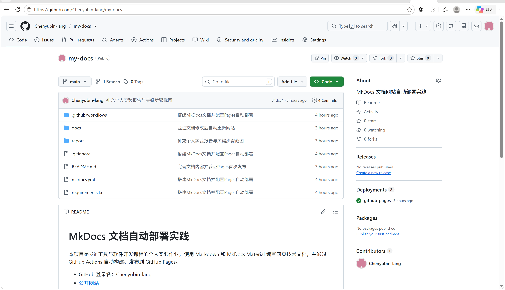
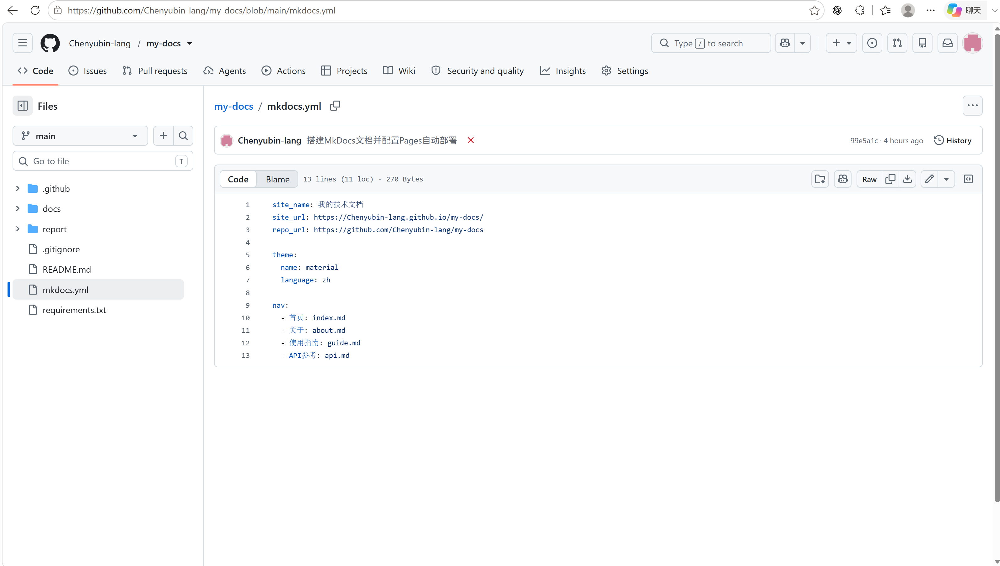
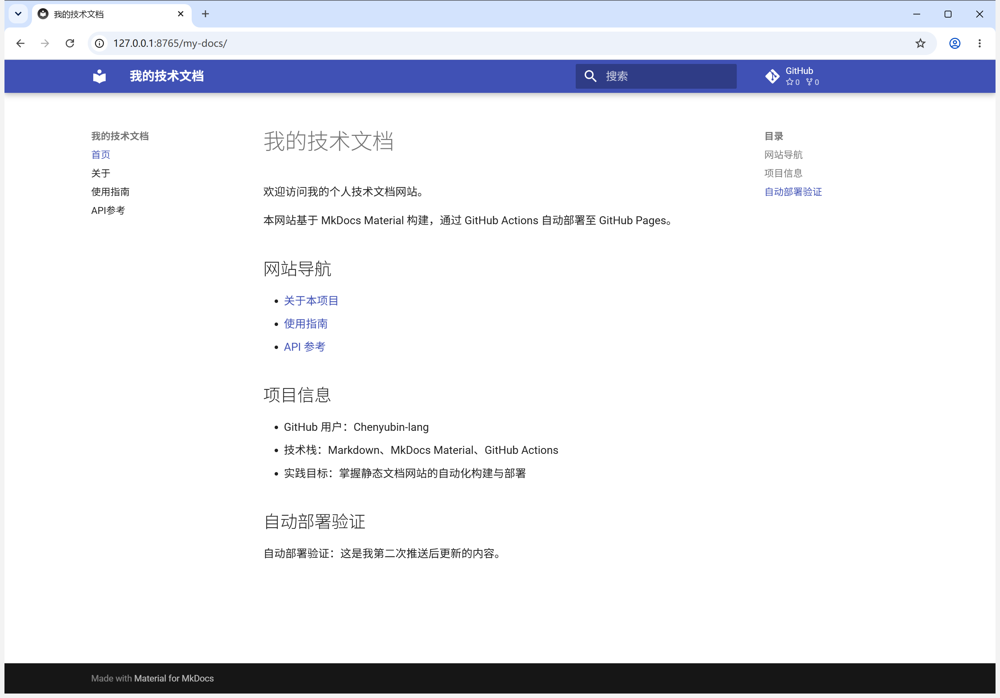
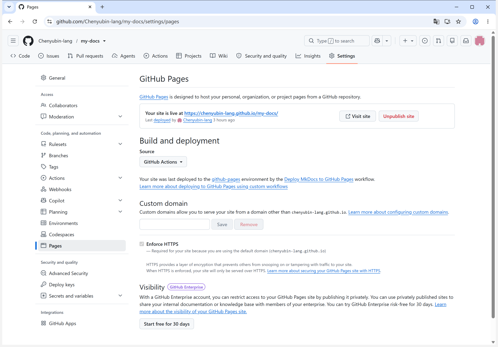
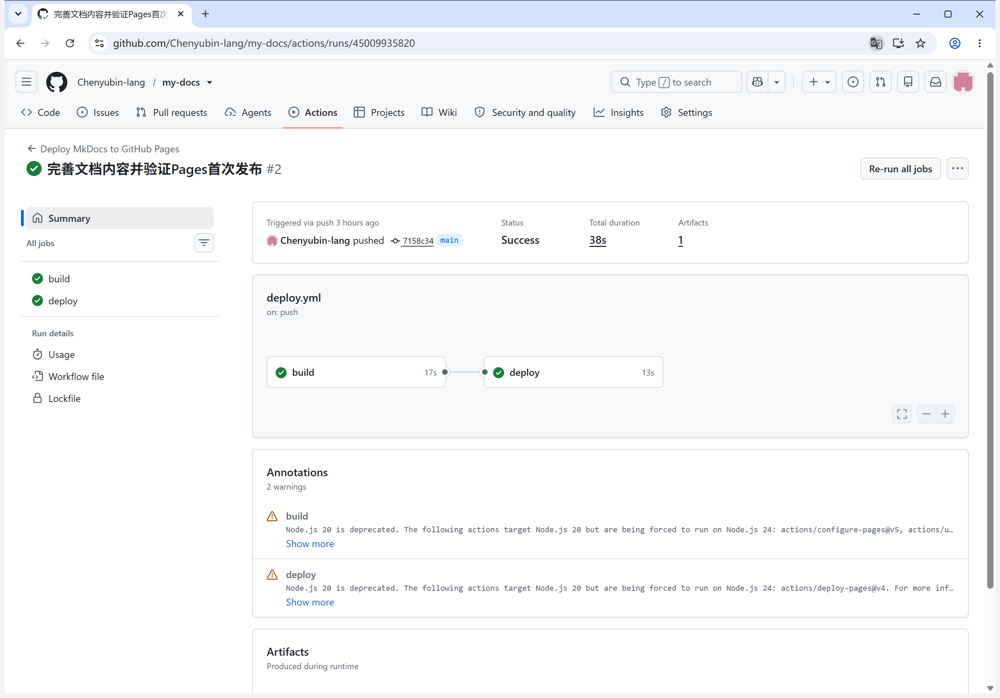
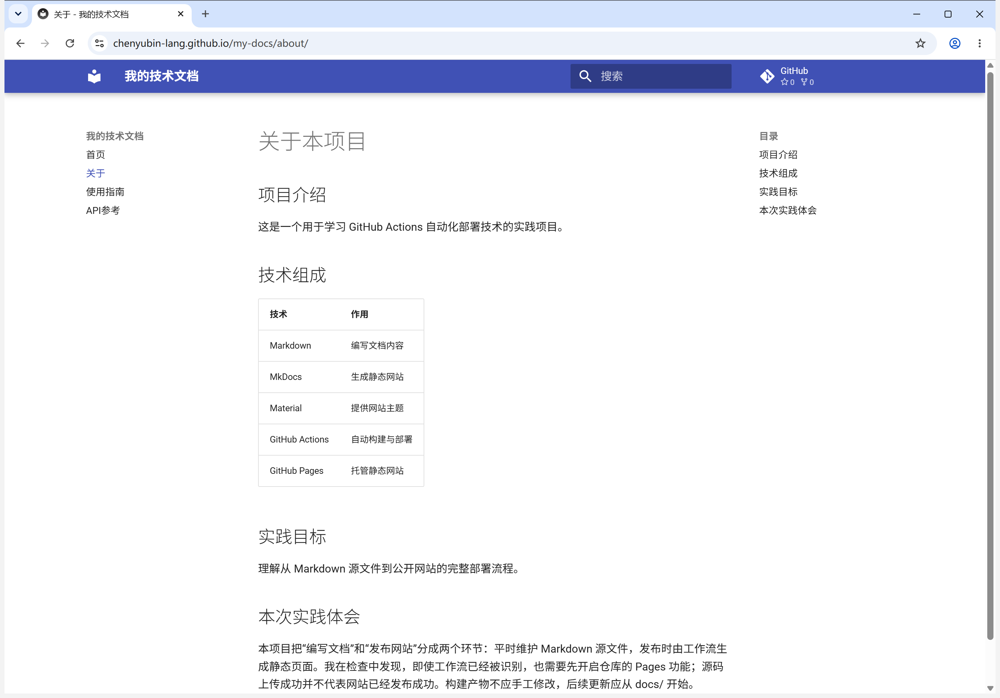
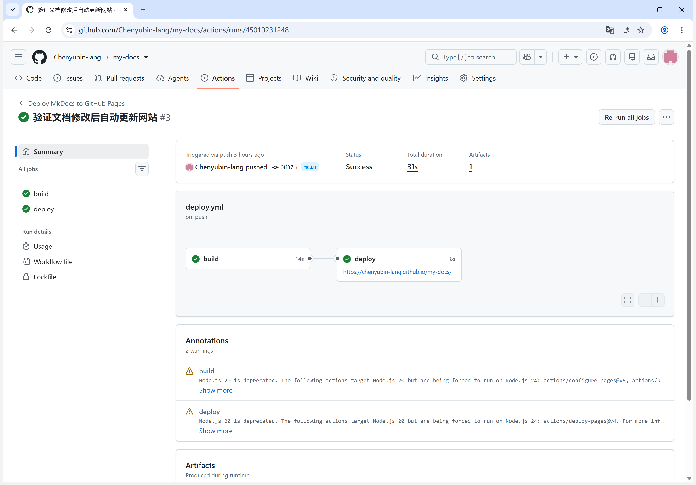
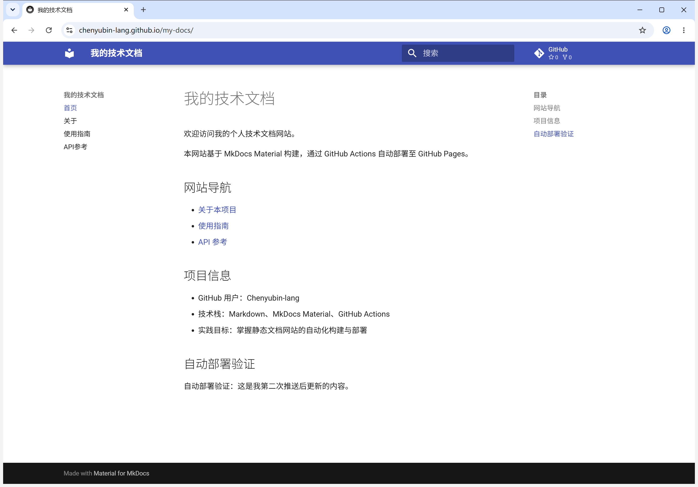

# 实践项目2：个人实验报告

## 1. 基本信息

- GitHub 登录名：Chenyubin-lang
- 个人源码仓库：https://github.com/Chenyubin-lang/my-docs
- 最终网站：https://chenyubin-lang.github.io/my-docs/
- 实践主题：通过 GitHub Actions 自动部署 MkDocs 静态文档到 GitHub Pages
- 实践日期：2026 年 11 月 22 日

## 2. 实践过程与关键截图

### 2.1 仓库创建

使用个人账号建立公开仓库 my-docs，默认分支为 main。公开仓库便于教师核验源码、提交记录和 Actions 运行结果。完成首次提交与推送后，远程仓库中可见文档及配置文件，未上传虚拟环境或 site/ 构建产物。



### 2.2 项目结构与 MkDocs 配置

在 docs/ 下编写 index.md、about.md、guide.md 和 api.md 四页文档。首页提供页面间链接，关于页介绍技术组成和实践体会，指南提供更新步骤与本地命令，API 页包含模拟响应及字段表格。

mkdocs.yml 使用 Material 主题和中文语言，填写个人站点地址及仓库地址。nav 的路径相对于 docs/，例如首页写 index.md，不能写 docs/index.md。docs/ 是可维护的源码，nav 决定网站导航，site/ 是构建后生成的 HTML、样式和脚本。site/ 可重新生成，已通过 .gitignore 排除。

工作流保存在 .github/workflows/deploy.yml。最初本地文件夹写成 workflow，检查后改为 workflows；GitHub 已识别并运行该工作流。



### 2.3 本地构建或预览

在 Python 3.12 虚拟环境中安装 requirements.txt 中的依赖。实际环境使用 MkDocs 1.6.1、MkDocs Material 9.8.1。执行严格构建，终端输出 Documentation built，命令退出码为 0。

```powershell
.\.venv\Scripts\python.exe -m pip install -r requirements.txt
.\.venv\Scripts\python.exe -m mkdocs build --strict
.\.venv\Scripts\python.exe -m mkdocs serve --dev-addr 127.0.0.1:8765
```

本次预览地址为 http://127.0.0.1:8765/my-docs/。使用 8765 是因为默认端口 8000 绑定被 Windows 拒绝。浏览器能打开本地首页并显示页面链接；随后在公开站点逐页核对四页内容、导航、表格和代码块。



### 2.4 Pages 设置

开启仓库 GitHub Pages，将发布来源设置为 GitHub Actions。这样工作流负责构建、上传并发布产物，不混用 gh-pages 分支发布。登录仓库设置页后确认 Source 显示 GitHub Actions，同时页面显示网站已发布的实际地址。



### 2.5 Actions 首次构建和部署

首次源码提交为 99e5a1c；该次运行在 Configure Pages 步骤失败，因为当时尚未开启 Pages。开启 Pages 后，完善文档并再次推送，成功完成第一次网站发布。

- [首次失败运行：定位 Configure Pages 步骤](https://github.com/Chenyubin-lang/my-docs/actions/runs/45008989252)
- [首次成功发布的提交 7158c34](https://github.com/Chenyubin-lang/my-docs/commit/7158c34d5e7cdd5c25ff304342911ff154338d30)
- [首次成功发布的 Actions 运行](https://github.com/Chenyubin-lang/my-docs/actions/runs/45009935820)

build 获取源码、配置 Python、安装依赖，运行严格构建，然后将 site/ 上传为 github-pages 产物；deploy 在 build 成功后发布产物。实际运行中两个任务均为 Success。



### 2.6 网站访问与四页导航检查

使用实际发布地址访问网站，保留浏览器地址栏截图。网站首页、关于、使用指南和 API 参考均已打开检查，并通过导航点击切换页面。

| 页面 | 检查内容 | 结果 |
| --- | --- | --- |
| 首页 | 项目信息、三处页面链接 | 正常 |
| 关于 | 技术组成表格、实践体会 | 正常 |
| 使用指南 | 更新步骤、本地命令代码块 | 正常 |
| API 参考 | JSON 示例、字段说明表格 | 正常 |

公开网页可访问，已检查的站内样式和脚本请求成功；关于、指南和 API 页的浏览器检查未发现控制台错误或警告。



### 2.7 第二次推送与自动更新验证

在首次发布成功后，修改 docs/index.md，增加以下易识别文字：

> 自动部署验证：这是我第二次推送后更新的内容。

提交并推送该文件后，没有手动启动部署。GitHub Actions 的事件为 push，对应提交与运行如下：

- [对应提交 0ff37cc](https://github.com/Chenyubin-lang/my-docs/commit/0ff37ccc5472014e04c54a1a48d0ae703cb8da52)
- [对应 Actions 成功运行](https://github.com/Chenyubin-lang/my-docs/actions/runs/45010231248)



等待运行成功后，重新加载公开网站并忽略浏览器缓存，确认新增文字已出现。公开首页的 HTTP 状态为 200，实际内容与本次提交一致，说明文档修改能够自动发布到网站。



## 3. 问题与解决

### 3.1 工作流目录名称

最初的本地路径为 .github/workflow/deploy.yml，目录少了末尾的 s。检查后改为 .github/workflows/deploy.yml 再上传。实际 Actions 运行证明 GitHub 已识别配置。

### 3.2 首次部署在 Configure Pages 失败

第一次运行中 Checkout source、Set up Python 成功，Configure Pages 失败，后续构建步骤和 deploy 被跳过；当时公开网站返回 404，仓库尚未开启 Pages。解决操作是开启 Pages 并使用 GitHub Actions 发布来源，再推送文档修改。后续 build、deploy 均成功，公开网站可访问。

### 3.3 默认本地端口绑定失败

启动 127.0.0.1:8000 时，终端报 PermissionError: [WinError 10013]，表示系统拒绝绑定该套接字。本次没有进一步确定端口被拒绝的系统原因，改用 127.0.0.1:8765 后成功启动预览，不需要修改文档内容。

### 3.4 提示信息与缓存

本地构建显示 Material 后续维护安排的提示，但构建仍成功，退出码为 0，没有因此更换作业要求的工具。Actions 还显示部分官方 Action 的 Node.js 运行时弃用警告，运行最终为 Success；本次保留课程提供的工作流。第二次发布后普通访问一度仍看到旧首页，忽略缓存重新加载后出现新文字，因此同时核对运行状态、提交版本和网页内容。

## 4. 原理理解

### 4.1 docs/ 和 site/ 各保存什么？为什么不用手工修改 site/？

docs/ 保存需要维护的 Markdown 源文件；site/ 保存 MkDocs 生成的 HTML、CSS、JavaScript 等静态资源。重新构建会覆盖 site/，手工修改会丢失，也不会回写到 Markdown。正确做法是修改 docs/ 并重新构建，因此不将 site/ 提交到 main。

### 4.2 本次工作流在什么情况下自动运行？

main 分支收到 push，且改动涉及 docs/**、mkdocs.yml、requirements.txt 或 .github/workflows/deploy.yml 中至少一项时自动运行。workflow_dispatch 也允许从 Actions 页面手动运行，但第二次自动更新验证使用的是 push 触发。

### 4.3 build 与 deploy 两个任务有什么区别？

build 负责获取源码、设置 Python 3.12、安装依赖、严格构建并上传 site/。deploy 负责把已上传的产物发布到 Pages。needs: build 保证构建成功后才部署；pages: write 授予发布权限，id-token: write 用于获取官方部署所需的身份令牌。github-pages 是记录和管理本次网站部署的环境，其网址来自部署步骤的 page_url 输出。

### 4.4 只修改 report/README.md 会触发部署吗？为什么？

不会。工作流的 push.paths 没有包含 report/README.md；如果一次提交只修改报告，不满足路径过滤条件。根目录 README 同样不在过滤列表中。报告保存在仓库中即可，不需要重新发布网站。

### 4.5 本次方案为何无需创建 gh-pages 分支？

本次使用官方 Pages Actions 流程，先由 upload-pages-artifact 上传 site/，再由 deploy-pages 将产物发布到 Pages。网站产物通过工作流传递，不需要用一个 gh-pages 分支保存，也不需要自行申请访问令牌或开启创建、批准 PR 的权限。
